# Spotify review pipeline: 660,622 reviews → a traceable product recommendation

**Question:** at the end of the May 2022 – Nov 2023 review window, where should Spotify's next quarter of product effort go:
**access, usability, playback, or billing/support?**

A staged, code-orchestrated multi-agent pipeline labels every review, verifies a random sample with an independent model,
groups complaints into stable issues, ranks them deterministically, and writes a decision memo whose every number is
checked against saved calculations. Everything a grader needs is saved in this repository and can be inspected or
recomputed **without an API key**.

> **Live dashboard:** [spotify-review-pipeline-ten.vercel.app](https://spotify-review-pipeline-ten.vercel.app) (public, no login) · **Final memo:** [memo.md](memo.md) · **Grading export:** [grading/](grading/) ·
> **Cost calculator:** [cost/report.md](cost/report.md) · **Study guide:** [docs/explain_it.md](docs/explain_it.md)

## Results summary (final full run)

**Recommendation: billing/support first, led by free-tier restrictions (ISS-billing-free_tier_restrictions), then ads
frequency, with playback stops/skips as the leading alternative.** Full argument: [memo.md](memo.md).

| | value | source |
|---|---|---|
| Source rows accounted for | **660,622 / 660,622** (0 missing, 0 duplicate) | [grading/records.jsonl.gz](grading/records.jsonl.gz) |
| Completed classifications | **660,503 / 660,609** nonempty (99.984%) | [runs/full/run_summary.json](runs/full/run_summary.json) |
| Quarantined | 119 = 13 empty texts + 106 malformed model output after one retry (reasons per record) | [runs/full/quarantine.jsonl](runs/full/quarantine.jsonl) |
| Exact-text reuse | 176,420 records via `cache_source_id`; 484,083 distinct texts labeled by the model | |
| Golden-set agreement (50 human labels) | topic 0.62, intent 0.74, severity exact 0.68 (MAE 0.38), sentiment within ±0.5 0.94 | [evals/golden/eval_final.json](evals/golden/eval_final.json), [error analysis](evals/failure_analysis.md) |
| Independent verifier (Jev, 200 random) | topic 0.75, intent 0.86, severity exact 0.775 (MAE 0.26); 76 flagged | [runs/full/verify/](runs/full/verify/) |
| Full-run API cost (measured) | **$3.62** (enrich $3.57 over 9,735 calls, verify $0.006, group $0.005, memo $0.04); whole project $3.86, reconciled with both provider consoles | [cost/report.md](cost/report.md), [cost/reconciliation.json](cost/reconciliation.json) |
| Full-run wall-clock (measured) | 8 min until the interrupt + 51 min resume (Message Batches, 8 in flight) + about 3 min downstream | [runs/full/run_summary.json](runs/full/run_summary.json) |
| Projection accuracy | the 10k checkpoint projected $3.54 (base) / $3.68 (conservative) for enrichment; the actual was $3.57 | [cost/report.md](cost/report.md) §3 |
| Course self-check | all IDs accounted, 176,420 valid cache reuses, coverage candidate 0.9999; only flag: the 106 quarantined | [evals/self_check.md](evals/self_check.md) |

**Measured vs. estimated:** costs and times above are measured from logged provider usage. Projections live only in
[cost/report.md](cost/report.md) §2–3 and are labeled as estimates.

## Rubric → evidence map

| Rubric item | Evidence |
|---|---|
| **D1** accessible code, setup and artifacts | [Setup](#setup-and-commands); [requirements.txt](requirements.txt); [.env.example](.env.example); all outputs committed under `runs/`, `grading/`, `cost/`, `evals/` |
| **D2** architecture, shared schema, provenance | [Architecture](#architecture); [labels/taxonomy.json](labels/taxonomy.json), [labels/subtopics.json](labels/subtopics.json), [labels/schema.json](labels/schema.json); `label_config` + `source_sha256` + `cache_source_id` on every record; [runs/full/data_manifest.json](runs/full/data_manifest.json) |
| **D3** memo numbers ↔ calculations ↔ evidence | [memo.md](memo.md) cites `claims.csv` IDs (C###, T###); [runs/full/memo_check.json](runs/full/memo_check.json) (code check of every number/ID); [One review traced end to end](#one-review-traced-end-to-end) |
| **D4** recommendation, alternatives, limitations | [memo.md](memo.md); [Limitations](#limitations) |
| **T1** 50 human labels, per-field comparison, error analysis | [evals/golden/golden_50_human.csv](evals/golden/golden_50_human.csv); [evals/golden/eval_final.json](evals/golden/eval_final.json); [Golden-set evaluation](#golden-set-evaluation) |
| **T2** independent verification + planted-error + injection tests | [runs/full/verify/](runs/full/verify/); [evals/system/report.md](evals/system/report.md) (T2 injection, T6 planted error) |
| **T3** real 100-review cold/warm pilot, offline calculator, retry/spend/recovery controls | [cost/report.md](cost/report.md); `python cost/calculator.py` (offline); `python cost/calculator.py selftest`; [evals/system/report.md](evals/system/report.md) T4–T5; [resume recording](#interruption-and-resume) |
| **W1** full ingestion, coverage, classification | [runs/full/ingestion_report.json](runs/full/ingestion_report.json) (checked against the course's published counts); `check_submission.py` output in [evals/self_check.md](evals/self_check.md) |
| **W2** staged program, bounded calls, saved handoffs, resume | `python -m pipeline run --input <csv>`; ≤ 50 reviews per enrichment request; per-stage handoff files in `runs/full/`; [runs/full/recording/](runs/full/recording/) + `grading/checkpoint_before.json` / `checkpoint_after.json` |
| **W3** reproducible ranking + deployed dashboard on a DB with grounded AI recommendations | `python -m pipeline rank --records grading/records.jsonl.gz --membership grading/membership.csv --out /tmp/rerank`; [Dashboard](#dashboard-backend-and-database) |

## Architecture

```mermaid
flowchart LR
  CSV[(spotify_reviews_18months.csv<br/>660,622 rows)] --> ING
  subgraph Code["Code (orchestrator: pipeline/cli.py)"]
    ING[1 Ingest + profile<br/>hash rows, quarantine 13 empty,<br/>dedupe → 484,189 texts]
    VAL[validate lines, consistency rules,<br/>exact quote + entities,<br/>copy to duplicate texts]
    GRP[4 Group: issue = topic.subtopic<br/>membership.csv]
    RNK[5 Rank: count × mean severity<br/>ranking.csv, claims.csv]
    CHK[check every number / ID<br/>the memo cites]
    LED[(spend ledger · rate limits ·<br/>retries · SQLite state)]
  end
  subgraph Models["Models (language judgment only)"]
    HAI[2 Enrich: Claude Haiku 5.5<br/>Message Batches, ≤50 reviews/request]
    JEV[3 Verify: Jev / TypeSafe<br/>200 random, blind]
    NAM[Group names: Haiku<br/>bounded examples]
    SON[6 Memo: Claude Sonnet 5.5<br/>aggregates + evidence pack only]
  end
  ING -->|pending distinct texts| HAI -->|coded lines| VAL
  VAL -->|invalid/missing: 1 retry, then quarantine| HAI
  VAL --> JEV --> GRP
  VAL --> GRP --> NAM --> RNK --> SON --> CHK
  CHK --> OUT[(runs/full/*, grading/,<br/>memo.md)]
  OUT --> LOAD[tools/load_db.py] --> DB[(Neon Postgres)] --> API[Vercel API<br/>api/*.js] --> UI[Dashboard<br/>public/index.html]
```



**Where code decides vs. where a model judges.** Code chooses the work (pending queue, dedupe, request size, which
batches to submit, retries, when to stop), and owns every count, sum and rank. Models are called only for language
judgment: Haiku reads review text, Jev gives an independent second opinion, Haiku names issue groups, Sonnet writes
prose from numbers it is given. A model never produces a number we report.

### Stage contracts

| Stage | Owner | Input | Output (saved handoff) | Failure behavior | Stop condition |
|---|---|---|---|---|---|
| 1 Ingest | code | any CSV path | SQLite `reviews` + `records`; `ingestion_report.json` | malformed CSV → abort before any call | all rows read |
| 2 Enrich | Haiku 5.5 + code | pending distinct texts | `records` (completed/quarantined), `calls`, `batches`; `enriched.jsonl.gz`, `quarantine.jsonl` | invalid/missing line → 1 retry → quarantine with reason; 429/5xx → bounded backoff (4 attempts); open batches collected on resume | queue empty, spend/time cap, or SIGINT |
| 3 Verify | Jev + code | seeded random 200 completed origins (text only) | `verify/verifier_predictions.jsonl`, `disagreements.csv`, `verify_report.json` | failed call → reported, excluded from agreement | sample done |
| 4 Group | code (+ Haiku names) | completed complaint/cancellation records | `membership.csv`, `issues.json`, `group_evidence_pack.json` | naming failure → issue IDs kept, names blank | all records mapped |
| 5 Rank | code | records + membership | `ranking.csv`, `aggregates.csv`, `topic_aggregates.csv`, `trends_*`, `claims.csv`, `topic_claims.csv` | n/a (deterministic) | — |
| 6 Recommend | Sonnet 5.5 + code | `memo_evidence_pack.json` only | `memo.json`, `memo.md`, `memo_check.json` | unknown number/ID → retried once, else saved as failed (visible) | memo passes the check |

## Design decisions (all measured)

1. **Bulk labeler: Claude Haiku 5.5 via the Message Batches API, not Jev.** In the smoke test, Jev billed 738 input
   tokens for a four-word review: the question text is resent for every review (one review per request), which
   projected to ≈ $15 for 484k texts. Haiku reads 50 reviews per request, so the ~3.1k-token instructions are amortized,
   and prompt caching cut them to 10% of the price. Asking for one coded line per review (`r7 P crash_freeze C 4 -2 0`)
   instead of JSON reduced output from 61 to ≈ 18 tokens per review. The Batch API halves the rate. Measured on development
   data (rows 9,951–10,000 of `analysis_10000.csv`, never the golden set); see the `smoke` calls in the run logs.
2. **Jev as independent verifier.** A different model from a different provider, with its own fixed questions, never
   shown the first label. Cheap at sample scale.
3. **Code extracts quotes and entities.** Quotes are guaranteed exact substrings and cost no output tokens; whether
   they *support* the label is evaluated on the golden set.
4. **Exact-text reuse.** 176,420 reviews repeat another review's exact text; one validated result is copied with
   `cache_source_id` under the identical `label_config`. Every original ID remains its own record and counts separately.
5. **Most-duplicated texts first.** If any cap stops the run early, the completed fraction of *rows* is maximized
   (the first 30k texts already covered 206k reviews).
6. **Effort low, thinking disabled, output cap 2,000 tokens per request.** The lowest setting that produced valid
   output on the development checkpoints (0.2–0.4% of reviews needed a retry).

## Golden-set evaluation

`python evals/golden_eval.py --from-run full` → [evals/golden/eval_final.json](evals/golden/eval_final.json) (per-case expected
labels, predictions and pass/fail). The 50 human labels were made before evaluation and never used in prompts, examples,
thresholds or issue discovery. The enrichment setup was frozen on development data before scoring, and no label was edited
afterwards. Missing/quarantined predictions would count as incorrect (there are none).

| field | result |
|---|---|
| topic / intent agreement | 0.62 / 0.74 (macro F1 0.464 / 0.491 on unambiguous cases) |
| severity exact / MAE | 0.68 / 0.38 |
| sentiment MAE (declared tolerance ±0.5) | 0.24 (0.94 within tolerance) |
| evidence quote exact substring / supports label | 1.00 / see error analysis |
| unsupported entity additions | 0 |
| needs_review as a prediction | 6 TP, 6 FP, 0 FN |
| ambiguous cases (alternates accepted) | 2 |

Most of the 27 disagreements sit on definition boundaries: generic praise vs. a specific topic (5), premium-only controls as
billing vs. usability (4), request vs. complaint (3), complaint severity 1 vs. 2 (3), and non-English text the human marked
unclear (3). Several look like reference-label slips against the written contract. Genuine model misses are context and sarcasm.
Details, the verifier pattern and the quarantine analysis: [evals/failure_analysis.md](evals/failure_analysis.md).

## One review traced end to end

**Review `126a881a-2462-458b-a8eb-064b4cd0f7d4`** (2 stars, 2023-07-22): *"…one night I remember that I was able to choose which
song I wanerd to play and an update later I cannot even choose a song of my choice first . I feel betrayed you money hungry app."*

1. **Source → ingest:** row hash `source_sha256` 17d5e3304af853a9…; stored with its original ID and fields (`grading/records.jsonl.gz`).
2. **Enrichment:** sent as local id `r47` in request `msgbatch_01NMwWFMW6kfmRs4YibMPvpN/inv3-g24-q74` (50 reviews, claude-haiku-5-5,
   batch tier, resume phase; 2,235 input / 917 output tokens, $0.000357 for the whole request). Raw model line:
   `r47 B free_tier_restrictions C 3 -2 0`. Code validated it, applied no adjustment, mapped sentiment -2 → -1.0, and used the full
   text as the evidence quote (an exact substring). Final labels: billing / billing.free_tier_restrictions / complaint / severity 3.
3. **Verification:** in Jev's seeded random sample, labeled blind: billing / complaint / severity 3 (topic confidence 0.84). Agrees.
4. **Issue membership:** `membership.csv` row `ISS-billing-free_tier_restrictions,126a881a-…` (one issue per review).
5. **Ranking:** that issue has 47,460 members, severity sum 138,070, mean 2.909187, score 138,070: rank 2 overall, the top specific
   issue (`ranking.csv`; claims C005–C008). Rebuilding the ranking from saved files reproduces it byte for byte.
6. **Memo claim:** "Free-tier restrictions have 47,460 complaints [C005], a severity sum of 138,070 [C006]…". `memo_check.json`
   confirms every number and ID in the memo exists in the evidence pack. On the dashboard, the review lookup (`/api/review?id=126a881a-2462-458b-a8eb-064b4cd0f7d4`) returns this record and its issue.

**A failed case:** review `03d3048d-e50b-4bdd-8da6-885612dfb89d` ("Over limit ads"). The model returned `r22 U U ads_frequency C 2 -1 0`
(a doubled topic code) on the first attempt and again on the retry. The line fails validation, so the review was **quarantined**
with that reason and `attempts = 2`, never guessed. It counts as an incomplete classification (one of 106).

## Interruption and resume

**Recording:** [play it on the dashboard](https://spotify-review-pipeline-ten.vercel.app/recording.html) · [runs/full/recording/session.cast](runs/full/recording/session.cast)
(asciinema v2) · [demo_summary.json](runs/full/recording/demo_summary.json). A real terminal session of the full run, recorded by
[tools/record_resume_demo.py](tools/record_resume_demo.py):

| snapshot | completed | pending |
|---|---|---|
| before the run (`inv2_start`) | 0 | 660,609 |
| at the interrupt (`inv2_end` = [grading/checkpoint_before.json](grading/checkpoint_before.json)) | 206,059 | 454,550 |
| after the resume (`inv3_end`; [grading/checkpoint_after.json](grading/checkpoint_after.json)) | 660,503 | 0 |

SIGINT (exactly what Ctrl-C sends) was sent 471 s in, after the first Message Batches were collected. The run stopped admitting work
and exited with code 2, leaving 5 submitted batches recorded as open. The identical command then **collected those 5 batches
instead of resubmitting them**, skipped all 206,059 completed IDs (verified: none of the 8,135 enrichment calls submitted by the resume
contains a review ID completed before the interrupt) and finished the remaining 41 batches plus a retry round.

## Ranking rules

`priority(issue) = complaint_count × mean_severity = severity_sum` over completed **complaint and cancellation** records,
one issue per review (`allow_multi_issue: false`); sorted by descending score, then ascending issue ID. Means use six
decimals, half-up. Topic-group totals (billing and support combined as `billing_support`) answer the four-way question.
Trend comparisons use full calendar months only (May 2022 and Nov 2023 are partial) with denominators.

## Limitations

- Reviews are self-selected, public and historical; they are not a representative sample of Spotify users.
- No revenue, plan tier or churn data: cancellation language is **stated intent**, not observed churn; no revenue-at-risk claims.
- Stars are metadata only; severity follows the shared definitions, not star ratings.
- Labels are model judgments with measurable disagreement (verifier, golden set); `needs_review` flags uncertain cases.
- Timestamps have no timezone; months are bucketed as given.
- Generic criticism (`other`) is the largest bucket and ranks first under the required formula but is not actionable.

## Setup and commands

```bash
uv venv --python 3.12 && uv pip install -r requirements.txt     # Python 3.12
cp .env.example .env                                             # fill only for paid runs; offline checks need no keys
```

Dataset: download the course ZIP ([Google Drive](https://drive.google.com/file/d/1P0rUoAS_wVjp3BYKqXMEyD4u0uJP1Bvf/view)),
place `spotify_reviews_18months.csv` (SHA-256 `1fc85de68a304dd8978b537cfa58793d5f41cbaf417fa32cb53899f83a2fcef6`) and the
other files in `data/raw/`. Source: BwandoWando, *3.4 Million Spotify Google Store Reviews* v2 (Kaggle, CC0).

| Purpose | Command | Paid? |
|---|---|---|
| Full pipeline on any CSV | `python -m pipeline run --input <csv> --run <name>` | yes |
| Offline cost/runtime replay | `python cost/calculator.py` | no |
| Calculator self-test | `python cost/calculator.py selftest` | no |
| Paid 100-review pilot | `python cost/calculator.py pilot --confirm-paid` | yes (≈ $0.04) |
| Rebuild ranking from saved files | `python -m pipeline rank --records grading/records.jsonl.gz --membership grading/membership.csv --out /tmp/rerank` | no |
| Golden-set evaluation | `python evals/golden_eval.py` | no |
| System tests | `python evals/system_tests.py --confirm-paid` | yes (< $0.01) |
| Course self-check | see [evals/self_check.md](evals/self_check.md) | no |

Dependencies: anthropic 1.13.0, typesafe-sdk 0.7.4, python-dotenv 1.2.4, psycopg 3.3.6 (dashboard loader); Node ≥ 20 for the API.
Keys live only in a local `.env` (ignored by git); `.env.example` is blank.

## Dashboard, backend and database

**Live: [spotify-review-pipeline-ten.vercel.app](https://spotify-review-pipeline-ten.vercel.app)** (public; no login or key needed).

- **Database:** Neon Postgres holds all 660,622 processed records (labels, evidence quote, issue ID; no raw text beyond the quote),
  the 36 issues with ranking numbers, topic aggregates, monthly trends, the 82 claims, the AI recommendation and cards, and run
  metadata. It's loaded by [tools/load_db.py](tools/load_db.py) from the saved run outputs in one transaction (no model calls). An owner role
  loads; the deployed API uses a **read-only** role (verified: writes are rejected).
- **Backend:** Vercel serverless functions in [api/](api/) (`/api/overview`, `/api/issues`, `/api/issue?id=…`, `/api/review?id=…`,
  `/api/trends`, `/api/health`). Fixed, parameterized SELECTs; IDs validated; the database URL is a server-side env var.
- **Dashboard:** [public/index.html](public/index.html) shows overall metrics, priority by product area, monthly complaint shares, the
  baseline issue ranking (click an issue → member reviews and quotes), the AI-generated recommendation with clickable claim IDs
  and review IDs, quality/coverage figures and a review lookup. The numbers match `ranking.csv` and `claims.csv`.
- **Reload after a new run:** `python tools/load_db.py --run full` (needs `DATABASE_URL_ADMIN` and `DATABASE_URL` in `.env`), then
  `vercel deploy --prod`.
